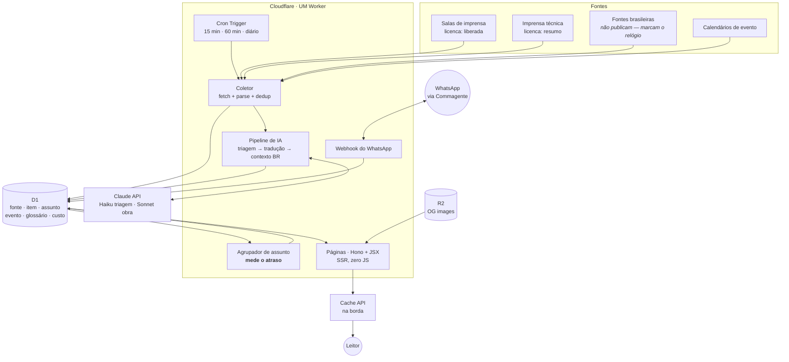

# Instituto Automação — Arquitetura (decisões e alternativas)

> **O que vamos usar, por quê, e o que ficou de fora.** Uma decisão por eixo, com as
> alternativas que foram consideradas e o motivo do veredito.
>
> **Legenda:** ✅ escolhido · ⛔ descartado (com motivo) · 🔮 futuro (revisitar depois)

Contexto e razão de existir: [CONCEITO.md](../CONCEITO.md). Dados: [MODELO-DADOS.md](MODELO-DADOS.md).
Caminho de cada coisa: [FLUXOS.md](FLUXOS.md). Quem faz o quê: [ORGANOGRAMA.md](ORGANOGRAMA.md).

---

## 0. Visão em uma imagem

Um **único Worker** na Cloudflare faz tudo: serve as páginas, roda o coletor no cron e
recebe o webhook do WhatsApp. Um `wrangler deploy` e acabou — não há segundo artefato,
não há pipeline, não há servidor.



---

## 1. Formato geral — **um Worker só** ✅

| Opção | Prós | Contras | Veredito |
|---|---|---|---|
| **Um Worker (páginas + cron + webhook)** ✅ | um deploy, um log, um lugar para debugar; sem build de site; custo perto de zero | escala tudo junto (irrelevante nesse volume) | **Escolhido** — é literalmente "leve de início" |
| Pages para o site + Worker para o coletor | separação limpa | dois artefatos, dois deploys, e o site precisaria consultar o mesmo D1 de qualquer jeito | ⛔ complexidade sem ganho |
| VPS (como o Commagente) | familiar, sem limites de runtime | infra para manter, backup, HTTPS, custo mensal — e a infra é do sócio | ⛔ peso desnecessário |

**Armadilha conhecida:** promessa não esperada é **cancelada** quando a resposta sai. O
coletor precisa de `ctx.waitUntil`. O miniflare local deixa terminar, então esse defeito
**só aparece em produção** — já aconteceu em outro Worker desta casa.

## 2. Renderização — **Hono + JSX server-side** ✅

| Opção | Prós | Contras | Veredito |
|---|---|---|---|
| **Hono + JSX (SSR)** ✅ | ~14kb, roda nativo em Workers; componentes de verdade; **zero JS no cliente**; sem build de site | JSX no servidor é menos comum que no cliente | **Escolhido** |
| Template string no Worker | zero dependência; é o que já se faz aqui | função de 800 linhas de HTML mata qualquer refinamento de front | ⛔ o front é prioridade declarada |
| Astro | ótimo para conteúdo, SEO impecável | traz build e um segundo artefato; e como o radar muda a cada 15 min acabaria em SSR do mesmo jeito | ⛔ complexidade sem ganho aqui |
| Next.js / React | ecossistema | hidratação que um site de leitura não precisa; peso e custo | ⛔ |

O sistema de design já está pronto e é CSS puro com tokens ([../design/](../design/)) —
os componentes JSX vestem esse sistema, não trazem o seu.

## 3. Banco — **D1** ✅

| Opção | Prós | Contras | Veredito |
|---|---|---|---|
| **D1 (SQLite)** ✅ | SQL de verdade, junções, FTS5 disponível quando precisar; nativo do Worker; free tier folgado | limite de leitura por request → obriga paginar e cachear (que é o certo mesmo) | **Escolhido** |
| KV | rápido e barato | sem consulta; a agenda e o Panorama **precisam** de filtro e agregação | ⛔ |
| Durable Objects | estado forte | não é o problema aqui | ⛔ |
| Postgres externo | poder | latência de fora da borda + custo + credencial para guardar | ⛔ |

## 4. "Backoffice" — **o WhatsApp é o painel** ✅

Decisão do dono: sem backoffice a princípio. Ela resolve mais do que parece.

| Opção | Prós | Contras | Veredito |
|---|---|---|---|
| **WhatsApp (Commagente)** ✅ | aprovar num toque, de onde estiver; o sócio publica sem ser dev; **dogfooding** do produto da casa; zero UI para construir e manter | depende do Commagente no ar | **Escolhido** |
| Painel web com login | familiar | auth, sessão, permissão, telas — o maior pedaço de software do projeto, para dois usuários | ⛔ |
| Markdown no repo + deploy | versionado, gosto de dev | o sócio não vai commitar Markdown. Mataria o núcleo Indústria no mês 2 | ⛔ |
| CMS externo | pronto | mais um serviço, mais um custo, mais um lugar com os dados | ⛔ |

🔮 Se um dia precisar de tela, ela nasce como **página do próprio site protegida por token**,
não como aplicação separada.

## 5. IA — **Claude, dois modelos por etapa** ✅

| Etapa | Modelo | Por quê |
|---|---|---|
| Triagem (isto é notícia ou ruído?) | **Haiku 4.5** | volume alto, decisão binária, precisa ser barato |
| Classificação (núcleo, tema, fornecedores, UF) | **Haiku 4.5** | extração estruturada, tarefa fácil |
| Resumo curto (fonte `resumo`) | **Haiku 4.5** | 3 a 5 linhas |
| Tradução integral (fonte `liberada`) | **Sonnet 5** | é obra publicada com o nome do Instituto; erro de termo custa autoridade |
| Contexto BR ("o que isso muda aqui") | **Sonnet 5** | é a camada que justifica o site existir |

⛔ **Um modelo só para tudo**: ou fica caro na triagem, ou fica ruim na tradução.
⛔ **Workers AI**: mais barato, mas a qualidade de tradução técnica PT-BR não se compara —
e a tradução é o produto.

**Controle de custo é parte da arquitetura, não um extra:** contador diário em `custo_dia`,
e teto que **pausa o coletor** ao bater o limite. Sem isso, um feed que enlouquece vira
uma conta que não é sua (acordo interno, ponto 2).

O **glossário entra no prompt** de tradução como dicionário obrigatório, em **duas colunas**:

| Coluna | Regra |
|---|---|
| termo com equivalente consagrado | a tradução é obrigatória e não admite variação |
| termo **sem** equivalente no setor | **fica na língua de origem**, com o significado aproximado entre parênteses na primeira ocorrência |

A segunda coluna é a que protege o texto. Inventar equivalente em português que ninguém usa
no chão de fábrica é **pior** que manter o estrangeirismo: denuncia tradução automática na
primeira linha e queima a credibilidade do texto inteiro. Na dúvida, o prompt manda manter e
explicar — *brownfield (planta já existente, com parque instalado a integrar)*.

Nome próprio de produto, linha, norma e protocolo nunca se traduz.

### De quem é a conta que paga

O pipeline **simula** — não chama a API — enquanto qualquer uma destas for verdade: falta a
chave, falta `IA_CONTA` declarado, ou `IA_SIMULAR=1`.

Exigir `IA_CONTA` é deliberado. A conta de API é do sócio (acordo interno ponto 2),
e chave de IA é a coisa mais fácil do mundo de aparecer por engano — variável de ambiente
esquecida, `.dev.vars` de outro projeto, cópia de configuração. Sem a declaração explícita, o
código se recusa a chamar. `/saude` expõe o estado (`modo` e `conta`), e o QA falha se algo
tiver sido gasto enquanto o modo era simulação.

## 6. Medir o atraso — **tabela `assunto`** ✅

A pergunta-assinatura é *"o atraso entre a fronteira lá fora e o chão de fábrica daqui"*.
Isso deixa de ser tema editorial e vira **requisito de schema**.

Para medir, o radar precisa:
1. agrupar itens de fontes e idiomas diferentes que falam da **mesma coisa** (`assunto`);
2. coletar **fontes brasileiras** — que quase nunca são publicadas, mas marcam o relógio;
3. gravar `atraso_br` = primeira menção brasileira − publicação original.

⚠️ Impossível fazer retroativamente: notícia sai do ar e feed não guarda histórico. Entra no dia 1,
mesmo que a tela não mostre nada disso ainda.

Agrupamento no P0 é simples e honesto: normalização de título + fornecedores citados em comum
+ janela de 30 dias. 🔮 Embeddings quando o volume justificar.

## 7. Cache — **Cache API na borda** ✅

HTML de listagem cacheado por 5 min; página de item por 1 h; purge no publish. É o que deixa
o site instantâneo em 4G — que é a condição real de quem lê isso no chão de fábrica.

⛔ Site estático com rebuild: o radar muda a cada 15 min, viraria pipeline de build o dia todo.

## 8. Rotas — **sem prefixo de idioma** ✅

Decisão do dono: **só português, para sempre.**

```
/                      capa
/industria             núcleo (radar + leitura)
/industria/<slug>      item
/observatorio          núcleo (radar + análise)
/operacao              núcleo (radar) · /operacao/casos
/edificacoes           núcleo (radar)
/agenda                calendário · filtros por querystring
/agenda/<slug>         evento
/panorama              relatórios
/glossario             termos
/transparencia         entra no gatilho (ver CONCEITO §4)
/feed/<nucleo>.xml     RSS por núcleo
/sitemap.xml
```

Filtro é `<form method="get">` → querystring → SSR. Cada combinação vira URL própria:
indexável, linkável e mandável no WhatsApp para o organizador da feira.

## 9. Analytics — **Cloudflare Web Analytics** ✅

| Opção | Veredito |
|---|---|
| **Cloudflare Web Analytics** ✅ | sem cookie, sem banner de LGPD, grátis, já está na conta. Coerente com um site que se apresenta como isento |
| GA4 | ⛔ cookie, banner, e entregar o comportamento do leitor ao Google não combina com a página de transparência |
| Plausible / Umami | ⛔ bom, mas é mais um serviço e mais um custo para o mesmo resultado |
| PostHog | ⛔ é ferramenta de produto, não de veículo de leitura |

## 10. Imagens — **a licença governa, não o formato** ✅

*Revisto em 30/08/2026. A regra anterior era "nunca republicar imagem de terceiro" — certa no
espírito, errada na formulação: tratava o formato como o critério, quando o critério é a
licença.*

Sala de imprensa de fabricante **licencia imagem junto com o texto**, para cobertura
editorial: é material feito para ser republicado. Usar a foto do press kit na manchete não é
exceção — é a mesma regra funcionando.

Por isso **a licença de imagem é campo próprio**, separado da de texto: uma fonte pode liberar
texto e não liberar foto, e o contrário também acontece.

| `fonte.licenca_imagem` | O que o pipeline pode fazer |
|---|---|
| `liberada` | copiar a imagem para o R2 e exibir **com crédito visível** |
| qualquer outro valor (padrão) | nada. Cai na OG gerada |

Três condições, nenhuma opcional:

1. **Só de fonte com `licenca_imagem = 'liberada'`.** Imprensa técnica (`resumo`) nunca —
   ela não licencia nada.
2. **Nunca hotlink: copia para o R2.** A banda deles não é nossa para gastar, a imagem some
   quando eles reorganizam o site, e hotlink entrega o IP dos nossos leitores ao servidor
   deles.
3. **Crédito visível**, sempre.

**Por que justamente na manchete.** Ela é o ponto de exposição máxima — a capa mais o card
que circula no WhatsApp e no LinkedIn. Abrir exceção ali seria o inverso do que faz sentido;
fazer a regra funcionar ali, não.

**Quando não houver imagem licenciada**, a capa é a **OG image gerada** pelo Worker (título +
núcleo + fonte), guardada no R2. Então o layout nunca fica com buraco, e o link circula com
cara de veículo — o que nenhum agregador consegue.

⚠️ Consequência de cronograma: com manchete ilustrada na capa, o gerador de OG image sai do
backlog e entra no **caminho crítico**.

## 11. O que fica de fora, e quando volta

| Item | Quando |
|---|---|
| Fila (Cloudflare Queues) | 🔮 se o coletor passar de ~30 s por invocação |
| Busca (FTS5 do D1) | 🔮 quando houver conteúdo o bastante para procurar |
| Envio de newsletter | 🔮 v0 só **captura** o e-mail no D1; o envio entra quando houver lista |
| Painel web | 🔮 só se o WhatsApp não der conta |
| Embeddings para agrupar assunto | 🔮 quando o agrupamento simples errar demais |

## 12. Convenções

- **Fuso:** tudo em UTC no banco; exibição em `America/Sao_Paulo`. Nunca gravar hora local.
- **Idiomas de origem no começo:** EN e DE. ES entra depois.
- **Slug:** gerado do título em PT-BR, sem acento, imutável depois de publicado.
- **Segredos:** só em `wrangler secret`. Nada de `.dev.vars` no git.
- **Repositório:** privado agora, público quando estiver apresentável e o acordo do código
  estiver por escrito (acordo interno, ponto 3).
