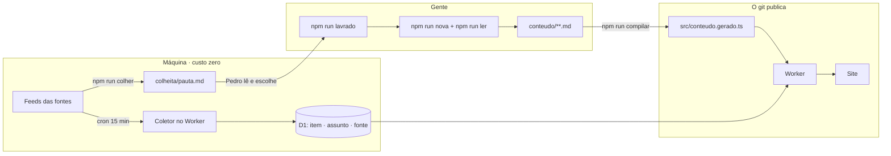

# Instituto Automação — Arquitetura e funcionamento · v2

> Escrito em 08/09/2026 para uma pessoa entender o sistema **sozinha**, sem quem o construiu por
> perto. Cobre da estrutura de pastas ao que acontece em cada requisição, em cada tick do cron e
> em cada comando. Onde o código tem uma decisão que não é óbvia, o motivo está no comentário do
> próprio arquivo; aqui fica o mapa que liga tudo.
>
> O que este documento **não** é: o plano (isso é [ROADMAP.md](ROADMAP.md)), a concepção
> ([CONCEPCAO-V2.md](CONCEPCAO-V2.md)) nem o registro das rodadas ([../qa/SPRINT-V2.md](../qa/SPRINT-V2.md)).
> A arquitetura da v1, com IA em produção e quatro núcleos, morreu em 03/09/2026 e está
> arquivada em [arquivo-v1/](arquivo-v1/).

---

## 0 · Como ler

Se você tem dez minutos, leia as seções 1, 2 e 14. Se vai mexer no site, leia 3 a 6. Se vai
mexer no coletor ou no banco, 7 a 9. Se vai publicar, 10 e a receita certa em 15. A seção 16
é o vocabulário interno; a 17 é o que está pronto e o que não está.

---

## 1 · O sistema em um parágrafo

Um único **Cloudflare Worker** (TypeScript, [Hono](https://hono.dev) com JSX renderizado no
servidor) serve um site em português sobre automação. O **conteúdo** são arquivos Markdown
dentro do repositório, compilados para um módulo TypeScript antes do deploy: o git é o sistema
de gestão de conteúdo. O **banco** (Cloudflare D1, SQLite) guarda só duas coisas: o que a
máquina colhe dos feeds das fontes, que é a base da medição de atraso chamada **relógio**, e o
que chega de fora pelos formulários (evento, assinatura da lista, contato). A cada 15 minutos o
**cron** do Worker roda o **coletor**, que lê feeds obedecendo o `robots.txt`, deduplica por URL
canônica e agrupa itens em **assuntos** para medir quanto tempo um tema publicado lá fora leva
até a primeira menção em fonte brasileira. **Não há inteligência artificial em produção**: toda
peça é escrita por um autor com nome, e o QA confere isso no bundle compilado.



Os **quatro tempos** da concepção aparecem no diagrama: colher (máquina), decidir (Pedro),
lavrar (quem escreve), publicar (git). O Worker só junta o que foi compilado com o que o banco
mediu.

---

## 2 · Mapa do repositório

```
instituto-automacao/
├── src/                    o Worker (roda na Cloudflare)
│   ├── index.tsx           entrada: cabeçalhos de segurança, monta as páginas, 404, cron
│   ├── config.ts           tipos do ambiente (Env), temas, atuações, redirects da v1, cache
│   ├── db.ts               TODO acesso ao D1 — rota não escreve SQL
│   ├── feed.ts             RSS, sitemap.xml e robots.txt
│   ├── estilo.ts           junta design/*.css num CSS só, com hash no nome
│   ├── parceiros.ts        a lista de parceiros (vazia hoje) — entra por commit
│   ├── tipos.d.ts          declara que *.css importa como texto
│   ├── conteudo.gerado.ts  GERADO pelo compilador (fora do git) — as peças e autores em memória
│   ├── conteudo/           tipos.ts (o contrato da peça) e index.ts (o índice do conteúdo compilado)
│   ├── paginas/            uma página por arquivo: capa, secoes (e a peça), agenda, glossario,
│   │                       blueprints, marca, autores, apoie, formularios, redirects, estatico,
│   │                       naoEncontrado, app (o tipo do app e o envelope <!doctype html>)
│   ├── ui/                 Documento (head, cabeçalho, nav, rodapé), pecas (todas as primitivas
│   │                       de tela), markdown (renderizador), jsonld, seo, marca (símbolo SVG),
│   │                       capa (arte gerada), tema (o único script da página)
│   ├── coletor/            index (o algoritmo do cron), feed (parser RSS/Atom/RDF),
│   │                       robots (lê e interpreta robots.txt), sitemap (sitemap-news), url
│   │                       (canonicalização, chave de assunto, slug)
│   └── giro/               semana (semana ISO) e auditar (números da prosa × dossiê)
├── conteudo/               O CONTEÚDO — markdown com frontmatter
│   ├── noticias/ artigos/ relatorios/ giro/     uma pasta por seção; AAAA-MM-DD-slug.md
│   ├── autores/            um .md por pessoa; toda peça aponta para um pelo nome
│   └── arte/               SVGs desenhados, vestidos pelos tokens (classes .a-*)
├── publico/                ASSETS servidos pela borda, fora do bundle (Workers Static Assets)
│   ├── imagens/ (fotos com licença) · autores/ (retratos) · parceiros/ (logos)
│   ├── fontes/ (5 woff2 self-hosted) · marca/ (SVGs da marca) · icones/ (PNG)
│   ├── og/ (GERADO: imagens de compartilhamento) · dados/ (CSV do dataset) · tour/ (vídeo)
│   ├── _headers            cache e segurança desses assets (o Worker não vê esses pedidos)
│   └── manifest.webmanifest
├── design/                 o sistema de design: tokens.css, base.css, components.css,
│                           SISTEMA.md, specimen.html e estudos (cabecalhos, direcoes, referencias)
├── scripts/                ferramentas locais (Node): colher, lavrado, ler, nova, dossie,
│                           compilar, medir-cadencia, sondar-fontes, sondar-vozes, testar-*
├── qa/                     verificar.mjs (afirma e falha), revisao.mjs (mede e registra),
│                           SPRINT-*.md e REVISAO-*.md (o que cada rodada revelou)
├── tour/                   o tour narrado: roteiro-site.mjs + motor/ (narrar, gravar, montar)
├── migracoes/              ALTER TABLE para banco que já tem dado (001–006)
├── colheita/               FORA DO GIT (exceto lidos.json): pauta, pendentes, leituras, dossiês
├── schema.sql fontes.sql vozes.sql seed.sql      o banco e as sementes
├── wrangler.toml           o Worker, o D1, o cron, os assets, o ambiente homolog
├── docs/                   este arquivo, CONCEPCAO-V2, EXECUCAO-V2, ROADMAP, FONTES, arquivo-v1/
├── README.md               como rodar e o ciclo de trabalho
└── acordo interno               o combinado com o sócio
```

---

## 3 · O ciclo de vida de uma requisição

1. **A borda decide quem responde.** Se o caminho existe em `publico/` (uma fonte, uma foto,
   o vídeo do tour), a Cloudflare serve o arquivo direto, com os cabeçalhos de
   `publico/_headers`. O Worker nunca vê esse pedido. Tudo o mais vai para o Worker.
2. **`src/index.tsx`** recebe. Um middleware envolve toda resposta com os cabeçalhos de
   segurança: `Content-Security-Policy` (só HTML), `X-Content-Type-Options`, `Referrer-Policy`,
   `Permissions-Policy`, `X-Frame-Options`, `Cross-Origin-Opener-Policy`. Se a variável
   `HOMOLOG` é `"1"`, também `X-Robots-Tag: noindex, nofollow` em tudo.
3. **O roteador casa na ordem** em que as páginas foram montadas: `estatico` (CSS, favicon,
   saúde, feeds, sitemap, robots) → `capa` → `secoes` → `agenda` → `glossario` → `blueprints` →
   `marca` → `autores` → `apoie` → `formularios` → `redirects`. Caminho fixo antes de curinga:
   um `/:slug` cedo demais engoliria tudo. O que não casa cai em `naoEncontrado` (404,
   `noindex`).
4. **A página monta o HTML** com `Documento` (head inteiro, cabeçalho, navegação, rodapé) e as
   primitivas de `ui/pecas.tsx`. O conteúdo vem do módulo compilado, em memória; o que é do
   banco (agenda, relógio, glossário, inventário) vem de `db.ts`, em uma ou duas consultas
   paralelas. A resposta sai com `Cache-Control` de `config.ts`: listagem 5 min na borda, peça
   1 h, CSS um ano.
5. **O navegador pede o CSS** em `/a/app-<hash>.css`. O hash muda quando o CSS muda; qualquer
   hash antigo também responde 200 com a folha atual, para cache velho nunca virar 404.
6. **Um script só roda na página:** o do tema (`ui/tema.ts`), liberado pela CSP por hash
   SHA-256. O compilador calcula o hash; o QA confere que o hash do HTML bate com o do
   cabeçalho. Mudou `tema.ts`, roda `npm run compilar`, senão a CSP bloqueia o script.

O **cron** entra pela outra porta: `scheduled()` em `index.tsx` chama `coletar()` dentro de
`ctx.waitUntil`. Promessa não esperada é cancelada quando a invocação termina, e o
miniflare local deixa terminar, então esse defeito só apareceria em produção.

---

## 4 · Os módulos do Worker

| Arquivo | Responsabilidade | O que não faz |
|---|---|---|
| `index.tsx` | Monta a ordem das páginas, os cabeçalhos de segurança, a CSP, a 404 e o cron | Não tem rota própria |
| `config.ts` | `Env` (DB, SITE_NOME, SITE_URL, HOMOLOG), `TEMAS`, `ATUACOES`, `REDIRECTS_V1`, `CACHE` | Não lê variável de ambiente sozinho: recebe pelo `c.env` |
| `paginas/app.ts` | `novaApp()` com `strict: false` (barra final não é 404) e `pagina()` que põe o `<!doctype html>` | — |
| `paginas/estatico.ts` | `/a/*.css`, `/favicon.svg`, `/saude` (JSON: ambiente, banco, peças, última coleta), `/feed.xml`, `/feed/<secao>.xml`, `/sitemap.xml`, `/robots.txt` | — |
| `paginas/capa.tsx` | A capa: parceiro, destaque, três notícias, lista, artigos, relógio, relatórios e agenda, quem escreve, giro | Não decide o destaque: pede a `conteudo/index.ts` |
| `paginas/secoes.tsx` | `/noticias`, `/artigos`, `/relatorios`, `/giro` e a página de cada peça (`/<secao>/<slug>`), com a ficha (veredito, fonte, autor) | — |
| `paginas/agenda.tsx` | `/agenda` com filtros por URL (`?t=`, `?f=`, `?o=`), `/agenda/<slug>`, e o `POST /agenda/enviar` que grava evento com `status='coletado'` para conferência humana | Não publica evento sozinho: alguém muda o status no banco |
| `paginas/glossario.tsx` | Duas listas do banco: traduções travadas e termos que não se traduzem | — |
| `paginas/blueprints.tsx` | O método aberto: tour, como funciona, veredito, como medimos, inventário de fontes com o veredito do robots, correções, dataset | — |
| `paginas/marca.tsx` | A prancha da marca prototipal, lendo `publico/marca/` | — |
| `paginas/autores.tsx` | `/autores`, `/autores/<slug>` (papel, bio, peças, link externo) e `POST /autores/escrever` → tabela `contato` | — |
| `paginas/apoie.tsx` | A única página comercial: regras do parceiro, quem apoia, `POST /apoie/enviar` → `contato` | — |
| `paginas/formularios.ts` | `POST /assinar`: e-mail obrigatório, atuação e empresa opcionais → `assinante` | — |
| `paginas/redirects.ts` | Os caminhos da v1 (`/industria`, `/panorama`, `/analise/...`) em 301 | — |
| `paginas/naoEncontrado.tsx` | A 404, com `noindex` | — |
| `ui/Documento.tsx` | O `<head>` inteiro (título, descrição, canônica, Open Graph, Twitter, JSON-LD, fontes com preload, ícones, manifesto, feeds), a linha de data, o cabeçalho, a navegação com o botão de tema e o rodapé | — |
| `ui/pecas.tsx` | Todas as primitivas: Secao, Vazio, Aviso, Veredito, Arte, Etiquetas, Assinatura, PecaDestaque/Card/Linha, FonteCaixa, VereditoCaixa, AutorCaixa/Card, QuemEscreve, FaixaParceiro, Lista, Numero, EventoNaAgenda, FiltroAgenda, formulários | Não sabem de banco: recebem a peça pronta |
| `ui/markdown.ts` | O renderizador mínimo do corpo: escapa tudo ANTES de converter; h2–h4, parágrafo, lista, citação, regra, link http ou interno, negrito, itálico, código | Sem tabela, sem imagem embutida, sem HTML cru |
| `ui/jsonld.ts` | Organization, WebSite, NewsArticle/Article, ProfilePage, BreadcrumbList, CollectionPage, Event/ItemList, DefinedTermSet, Dataset — só o que a página já mostra | — |
| `ui/seo.ts` | Título da aba (≤ 53 + " — Instituto Automação"), descrição em até 158 caracteres cortada em fim de frase, URL absoluta | — |
| `ui/marca.ts` | O símbolo SVG (anel, raio, ponto) com classes para os tokens, e o favicon com cores cravadas | — |
| `ui/capa.ts` | A arte gerada quando a peça não tem foto nem arte desenhada: SVG determinístico pela semente, quatro motivos (radar, malha, sinal, blocos) | Não roda no navegador: é string no HTML |
| `ui/tema.ts` | O único script inline: lê `localStorage.tema`, aplica `data-theme`, alterna no clique | Não lê a preferência do sistema, por decisão |
| `conteudo/tipos.ts` | O contrato: `Peca`, `Autor`, `Imagem`, `Fonte`, seções, formatos, vereditos, licenças | — |
| `conteudo/index.ts` | O índice em memória: `todas`, `porSecao`, `obter`, `destaque`, `recentes`, `autores`, `autorDe`, `pecasDoAutor`, `caminho`, rótulos | Não lê arquivo: lê o módulo gerado |
| `db.ts` | Relógio, saúde da coleta, agenda (listar, obter, contar), glossário, inventário de fontes, correções, assinar, contato | — |
| `feed.ts` | RSS por seção e geral (40 itens), sitemap (páginas, peças, autores com peça, eventos futuros), robots (fechado na homologação; `Disallow` só nos POSTs) | — |
| `estilo.ts` | Concatena `tokens + base + components`, tira comentários e recuo, calcula o hash djb2 e a rota | Não minifica agressivamente, de propósito |
| `parceiros.ts` | `PARCEIROS` (lista vazia) e `parceiroDaCapa()` | — |
| `coletor/*`, `giro/*` | Seções 7 e 8 | — |

---

## 5 · O conteúdo: arquivos, contrato e compilação

### 5.1 Onde mora

`conteudo/<secao>/AAAA-MM-DD-slug.md`. A data do nome tem de bater com `data:` no frontmatter;
o slug vira a URL `/<secao>/<slug>`. Autores em `conteudo/autores/<slug>.md`. Artes em
`conteudo/arte/*.svg`. Fotos em `publico/imagens/`.

### 5.2 O frontmatter de uma peça

YAML mínimo: `chave: valor` e um nível de aninhamento. O compilador recusa o que não entende
em vez de adivinhar.

| Campo | Obrigatório | O que é |
|---|---|---|
| `secao` | sim | `noticias`, `artigos`, `relatorios` ou `giro`; tem de bater com a pasta |
| `formato` | sim | notícias: `curta` ou `contexto` · artigos: `guia` ou `conceito` · relatórios: `caso`, `analise` ou `panorama` · giro: `giro` |
| `tema` | sim | `industria` ou `processos` |
| `titulo` | sim | o h1 |
| `titulo_curto` | não | 20 a 53 caracteres; vira o `<title>` e o headline do JSON-LD |
| `lead` | sim | o resumo; vira a descrição da página |
| `autor` | sim | o **nome** exatamente como está em `conteudo/autores/*.md` |
| `data` | sim | AAAA-MM-DD, igual à do nome do arquivo |
| `veredito` | só notícia | `chega`, `a_caminho`, `nao_chega` ou `sem_efeito`; proibido nas outras seções |
| `fonte:` | notícia sim; outras opcional | bloco com `nome`, `url` (http), `idioma`, `publicado` (opcional; é o que o relógio compara) |
| `imagem:` | não | bloco com `arquivo` (em `publico/imagens/`, jpg ou png, ≤ 600 KB, ≥ 600 px), `credito`, `licenca` (`press`, `cc-by`, `cedida`, `propria`), `alt`. Largura e altura são lidas do arquivo |
| `arte` | não | nome de um SVG em `conteudo/arte/`; sem cor crua, sem `<script>` |
| `destaque` | não | `true` na peça que abre a capa; o compilador aceita uma só |
| `numeros` | só giro | os inteiros que a prosa pode usar; a auditoria reprova qualquer outro |

O corpo é Markdown mínimo (seção 4, `markdown.ts`) e precisa de pelo menos 80 caracteres.
**Notícia tem de ter a seção `## O que isso muda aqui`**: é a camada que separa leitura de
tradução.

### 5.3 O autor

```
---
nome: Pedro Oliveira      # nome e sobrenome; é a chave que a peça usa
papel: Editor
ordem: 1                   # posição na lista; o editor primeiro
link: https://...          # opcional: o currículo lá fora
link_rotulo: LinkedIn      # opcional; padrão "Currículo"
foto: pedro.jpg            # opcional: quadrada, ≤ 200 KB, em publico/autores/
---
A bio, em markdown. Pelo menos 40 caracteres.
```

Peça cujo `autor:` não bate com nenhum `nome:` faz o build **abortar**. É o que torna a frase
do rodapé, "toda peça tem autor", verificável.

### 5.4 O compilador (`scripts/compilar.ts`)

`npm run compilar` lê tudo, valida, e escreve `src/conteudo.gerado.ts` com `PECAS`, `AUTORES`,
`ARTES` e `TEMA_SCRIPT_HASH`. Aborta com o arquivo e o motivo na tela em qualquer falha de
contrato: autor sem arquivo, notícia sem fonte ou sem veredito, veredito fora da categoria,
arte que não existe ou com cor crua, imagem sem crédito ou licença ou pesada demais, dois
destaques, giro com número que não está no dossiê.

Também produz o que a página precisa e o Worker não consegue fazer: as imagens de
compartilhamento (`publico/og/<secao>-<slug>.png`, 1200 × 630) rasterizadas da arte SVG ou da
capa gerada com o Chromium do Playwright, a imagem padrão do site e os ícones PNG. Só renderiza
o que falta ou envelheceu; o caminho comum não abre navegador. `publico/og/` fica fora do git,
então a máquina que faz deploy precisa do Chromium (`npx playwright install chromium`).

`npm run dev` e `npm run deploy` compilam antes de subir.

---

## 6 · O sistema de design

Três arquivos em `design/`, servidos como um CSS só:

- **`tokens.css`** é a fonte da verdade: cor, tipo, espaço, superfície. Nenhum valor bruto de
  cor vive fora dele, e o QA confere (P9). O tema escuro é um bloco `:root[data-theme="dark"]`
  que redefine os tokens. **Não há `prefers-color-scheme`**, por decisão do dono registrada no
  próprio arquivo: o claro é o site, o escuro só sai no botão.
- **`base.css`**: os `@font-face` das cinco fontes self-hosted com fallbacks de métrica ajustada
  (`size-adjust`, `ascent-override`…), que é o que zera o CLS quando a fonte web chega; reset;
  elementos; os dois modos de leitura, `.obra` (serifada, leitura longa) e `.fluxo`; impressão.
- **`components.css`**: as primitivas, comentadas com o porquê de cada decisão.

Três famílias com papel fixo: **Newsreader** para obra (título e texto de peça), **IBM Plex
Sans** para interface, **IBM Plex Mono** para dado (número, data, relógio). Duas cores com
trabalho fixo: azul é a instituição, laranja é a ação. A única cor com significado é a do
veredito. As artes desenhadas e a capa gerada vestem classes (`.a-*`, `.capa-gerada .*`) para
mudar de tema junto com a página.

---

## 7 · O banco (D1)

Oito tabelas. Quem escreve em cada uma:

| Tabela | O que guarda | Quem escreve | Quem lê |
|---|---|---|---|
| `fonte` | As fontes do radar: URL do feed, idioma, país, tema (`nucleo`, por herança), `licenca`, `colheita` (`feed` ou `sitemap`), intervalo, `marca_relogio`, voz (`pessoa`), e o veredito do robots (`robots_permite`, `robots_atraso`, `robots_motivo`, `robots_conferido`) | `fontes.sql` e `vozes.sql` (sementes); o coletor atualiza robots, `ultima_coleta`, `ultimo_erro`, `intervalo_min` | coletor, Blueprints, `colher.ts` |
| `item` | O que foi colhido: título, URL, URL canônica (única), idioma, resumo, data da fonte. Dez colunas, dado bruto | coletor | relógio, dossiê, dataset |
| `assunto` | Itens agrupados pela chave do título; `publicado_original`, `primeira_mencao_br`, `atraso_br_dias` | coletor | relógio, Blueprints |
| `evento` | A agenda; `status` `coletado` → `publicado` → `arquivado`; `origem` diz de onde veio | `seed.sql`, `POST /agenda/enviar` (nasce `coletado`), gente via SQL | agenda, capa, sitemap |
| `glossario` | Termo de origem → termo em português, nota, `manter_original` | `seed.sql` | glossário |
| `correcao` | Registro público de correções, apontando para a peça pelo caminho | gente via SQL | Blueprints |
| `assinante` | E-mail, origem, `atuacao`, `empresa` (006) | `POST /assinar` | ninguém ainda (a lista não envia) |
| `contato` | Quem quer escrever ou apoiar: tipo, nome, e-mail, empresa, mensagem (006) | `POST /autores/escrever`, `POST /apoie/enviar` | gente, via SQL |

**Instalação limpa:** `schema.sql` começa com `DROP TABLE` e recria tudo; `fontes.sql`,
`vozes.sql` e `seed.sql` semeiam. **Banco que já tem dado:** só migrações (`migracoes/001` a
`006`), porque item colhido não volta. Comandos na seção 15.

Um detalhe de nome: no banco o **tema** ainda se chama `nucleo` (fonte, assunto, evento). É
herança da v1, e mudar o nome da coluna não valia o risco.

---

## 8 · O coletor no cron (`src/coletor/index.ts`)

A cada 15 minutos, `coletar()` faz pouco por invocação, de propósito:

1. **Escolhe até 8 fontes vencidas:** ativas, não bloqueadas, com feed, cujo `intervalo_min`
   passou. Fonte recusada pelo robots não ocupa vaga, mas volta a ser conferida quando o
   veredito vence (7 dias).
2. **Uma fonte por host por tick.** Três feeds do Reddit em sequência devolveram 429; espaçar
   por host é mais honesto que aumentar o intervalo de todos. O que ficou volta no próximo tick.
3. **Lê o `robots.txt`** se o veredito tem mais de 7 dias, e grava o resultado com motivo e
   data. `null` (robots ilegível) vale como não: sem regra legível não há consentimento a
   inferir. Se pediu `Crawl-delay`, espera de verdade (teto 15 s) antes de buscar o feed.
4. **Busca o feed** com o User-Agent honesto (`InstitutoAutomacaoBot`, só ASCII), 10 s de
   limite. Se a fonte é do tipo `sitemap`, lê o sitemap-news; se veio um índice, desce **um**
   nível só, e reconfere o robots do filho.
5. **Parseia** (RSS 2.0, Atom, RDF ou sitemap-news), pega até 25 entradas, canonicaliza cada
   URL (tira `utm_*`, `fbclid` e companhia) e grava em `item` com `INSERT OR IGNORE`: a URL
   canônica é única, então repetição não entra.
6. **Liga cada item novo a um assunto** pela chave normalizada do título, dentro de uma janela
   de 30 dias. Fonte estrangeira marca ou antecipa `publicado_original`; fonte brasileira marca
   `primeira_mencao_br` **uma vez só**, e aí `atraso_br_dias` é calculado.
7. **Atualiza a fonte:** `ultima_coleta`, `ultimo_erro` (também em erro, senão a fonte quebrada
   come o orçamento das que funcionam) e `intervalo_min` (o Crawl-delay vira piso).

O relatório do tick vai para o log do Worker. Postura registrada em `robots.ts` e publicada em
Blueprints: nada de trocar user-agent, proxy ou navegador disfarçado. Fonte que bloqueia robô
não entra, e isso aparece no inventário.

**Localmente** o cron não roda sozinho. `npx wrangler dev --test-scheduled` abre a porta
`/__scheduled` para disparar um tick à mão.

---

## 9 · O relógio (`db.ts › relogio()`)

A pergunta-assinatura do site, medida sobre a tabela `assunto`:

| Número | Definição |
|---|---|
| assuntos acompanhados | `COUNT(*)` de `assunto` |
| medidos | assuntos com `atraso_br_dias` preenchido |
| atraso mediano | a mediana de `atraso_br_dias` |
| sem menção | assuntos publicados lá fora há mais de 90 dias e sem `primeira_mencao_br` |
| itens, fontes | `COUNT(*)` de `item` e de `fonte` ativa |

Na capa, se ainda não há par medido, a faixa mostra o que já foi lido em vez de um "0" fingindo
medida, e diz que a medida vale para as fontes acompanhadas, não para toda a imprensa. As
limitações estão escritas em Blueprints: o agrupamento por título erra entre idiomas distantes
e junta pouco (552 assuntos para 554 itens em 08/09), e há poucas fontes brasileiras marcando o
relógio. Embeddings para agrupar melhor estão no backlog do ROADMAP.

---

## 10 · As ferramentas locais (`scripts/`)

Rodam com `node --experimental-strip-types`, sem build. Todas leem o D1 **local** pelo
wrangler quando precisam do banco.

| Comando | Tempo | O que faz |
|---|---|---|
| `npm run colher` | 1 · colher | Busca as fontes ativas do D1 local, obedece robots, deduplica, e escreve `colheita/pendentes.json` (só cresce) e `colheita/pauta.md` (a vista para ler). **Não marca nada como lido** |
| `npm run lavrado` | 2 · decidir | O único que escreve em `colheita/lidos.json`: marca a pauta inteira como lida. `--ver` só mostra |
| `npm run ler -- <url>` | 3 · lavrar | Baixa um artigo, confere o robots daquele caminho, tira o ruído e salva em `colheita/leituras/`. É leitura; nunca vai para o site |
| `npm run nova -- <secao> <slug> --url <url>` | 3 · lavrar | Cria o `.md` com o frontmatter pré-preenchido a partir da pauta |
| `npm run dossie [-- 2026-s37]` | semanal | Os números da semana ISO que fechou, em SQL puro, para `colheita/dossie-<semana>.md`. O Giro é escrito em cima, e a auditoria confere cada inteiro da prosa contra ele |
| `npm run compilar` | 4 · publicar | Seção 5.4 |
| `npm run cadencia` | medição | Quanto cada fonte publica por semana, medido no feed inteiro |
| `npm run sondar` · `npm run sondar:vozes` | fontes | Testa candidatos a fonte e a voz contra o nosso parser e o robots. Toda fonte nasce `resumo` |
| `npm test` | conferência | As suítes de unidade: parser de feed e canonicalização, robots, semana ISO e auditoria |
| `npm run qa [-- <url>]` | conferência | Seção 11 |
| `npm run revisao [-- <url>]` | conferência | Seção 11 |
| `npm run tour` | vídeo | Seção 12 |

`colheita/` fica fora do git, exceto `lidos.json`, que é metadado nosso e impede um item
descartado de voltar à pauta.

---

## 11 · QA e revisão

**`qa/verificar.mjs` afirma e falha.** Mais de mil asserções em três eixos: **A** funcional
(rotas, cache, zero IA no bundle compilado por `wrangler deploy --dry-run`), **B** conformidade
(o que está no ar bate com o que os documentos prometem: peças, capa, agenda, glossário,
Blueprints, lista, tema, feeds, SEO, autores, artigos, parceiro, ficha) e **C** qualidade
(contraste calculado dos tokens, semântica, peso, sistema de design sem cor crua, imagem com
licença). Lê o D1 local pelo wrangler para comparar banco e página. Os testes que escrevem no
banco (assinatura, contato) só rodam contra `127.0.0.1` e apagam o rastro. Contra a
homologação sobram diferenças esperadas: robots fechado, teto de 300 ms, comparações com o
banco local viram aviso.

**`qa/revisao.mjs` mede e registra.** Playwright com `bypassCSP` (o axe injeta script): cada
página em três larguras e no escuro, axe-core, CLS, LCP, transbordo horizontal, alvos de toque,
texto miúdo, links quebrados, hosts de terceiro, e os fluxos (tema, teclado, capa → peça,
filtro, formulário, 404, impressão, movimento reduzido). Sai em `qa/revisao/medidas.json` e
screenshots, fora do git. A nota é dada por gente lendo isso; as notas estão em
`qa/REVISAO-*.md`.

Regra da casa: toda afirmação escrita em documento vira asserção no QA.

---

## 12 · O tour narrado (`tour/`)

`npm run tour` gera `publico/tour/instituto-automacao-tour.mp4`, o `.vtt` de legendas e os
capítulos, a partir do site rodando localmente: `roteiro-site.mjs` é o conteúdo (cenas, uma
frase de narração e uma ação por cena); `motor/` é genérico e veio dos tutoriais do Mettria.
Narra com edge-tts (voz pt-BR), grava com Playwright dirigindo o site com um ponteiro desenhado
no compasso das palavras, monta com ffmpeg. O vídeo está embutido em Blueprints. Mudou a tela,
regrava-se; mudar frase antes de regravar é de graça.

---

## 13 · Ambientes, deploy e o que a borda faz sozinha

| | Local | Homologação | Produção |
|---|---|---|---|
| Comando | `npm run dev` (compila + `wrangler dev --test-scheduled`) | `npm run deploy:homolog` | `npm run deploy` |
| Conta | — | Pedro (ryzecode08), `account_id` explícito no `wrangler.toml` | sócio (A2) — `database_id` ainda `PREENCHER-APOS-CRIAR` |
| D1 | `.wrangler/state` | `instituto-homolog` | `instituto` |
| URL | `http://127.0.0.1:8787` | `instituto-automacao-homolog.desbravando-utv.workers.dev` | o domínio do sócio |
| `HOMOLOG` | — | `"1"`: robots fecha tudo, `X-Robots-Tag: noindex` em tudo, `/saude` diz `homologacao` | — |
| Banco | `db:local` + sementes, ou `db:migrar` | `db:homolog` (sementes) e `db:migrar:homolog` | `db:remoto` + sementes e `db:migrar:remoto` |
| Cron | à mão, `/__scheduled` | a cada 15 min, de verdade | idem |

O que a borda faz sem o Worker: serve `publico/` com `_headers` (fontes, marca e ícones
imutáveis por um ano; imagens, dados e tour por um dia; `Accept-Ranges` no vídeo; `nosniff` e
`Referrer-Policy` em tudo). `SITE_URL` define canônica, `og:image` e sitemap; errar essa
variável erra tudo o que é absoluto.

---

## 14 · Segurança, SEO e o que a máquina lê

- **CSP estrita:** `default-src 'self'`; `script-src` só o hash do script do tema; estilo inline
  permitido (o HTML usa `style=""` em alguns lugares); imagem `self` e `data:`; nada de terceiro
  em lugar nenhum. Quem injeta script para testar (axe) precisa de `bypassCSP`.
- **Formulários:** honeypot (`sitio`), validação no servidor, redirecionamento 303, gravação
  com parâmetros vinculados. Evento nasce `coletado` e só aparece depois de conferência humana.
- **Markdown:** escapa antes de converter; link só `http(s)` ou caminho interno.
- **JSON-LD:** serializado com `<`, `>` e `&` escapados, porque nome de evento é texto de
  terceiro.
- **SEO:** título curto, descrição cortada em fim de frase, canônica, `og:image` com largura e
  altura em toda página, `article:*` nas peças, `og:type profile` nos autores, `noindex` em 404
  e em agenda filtrada, breadcrumb, feeds anunciados no `<head>`, sitemap com `lastmod`,
  `rel=author` na assinatura.

---

## 15 · Receitas

**Publicar uma notícia**
1. `npm run colher` → ler `colheita/pauta.md` → escolher → `npm run lavrado`.
2. `npm run ler -- <url>` e ler a fonte **inteira**.
3. `npm run nova -- noticias <slug> --url <url>`; escrever o corpo com `## O que isso muda aqui`;
   `veredito:`; se houver foto de imprensa com crédito escrito na página da fonte, salvar em
   `publico/imagens/` e preencher `imagem:`; senão, `arte:` ou nada (entra a capa gerada).
4. `npm run compilar` → `npm run qa` → commit → `npm run deploy:homolog` (ou `deploy`).

**Publicar um artigo:** igual, em `conteudo/artigos/`, `formato: guia` ou `conceito`, sem
`veredito`, `fonte:` só se houver.

**Um autor novo:** criar `conteudo/autores/<slug>.md` **antes** da primeira peça dele
(seção 5.3). Retrato opcional em `publico/autores/`.

**Um parceiro:** acrescentar em `src/parceiros.ts` (nome, url, frase, logo em
`publico/parceiros/`, desde). Entra por commit; a página `/apoie` e a capa mudam sozinhas.

**Um evento:** pelo formulário (`/agenda#enviar`) ele nasce `coletado`; publicar é
`UPDATE evento SET status='publicado', slug='...' WHERE id='...'` no D1 do ambiente, depois
de conferir a data no site oficial. Ou direto no `seed.sql` para instalação limpa.

**Uma correção:** `INSERT INTO correcao (id, peca, texto) VALUES (...)`; aparece em Blueprints.

**Uma fonte nova:** rodar `npm run sondar` com o candidato; se responder, entra em `fontes.sql`
como `resumo` e no D1 de cada ambiente. O coletor lê o robots dela no primeiro tick.

**O Giro da semana:** segunda-feira, `npm run dossie`; escrever `conteudo/giro/AAAA-MM-DD-2026-sNN.md`
com `numeros:` listando os inteiros do dossiê; o compilador audita a prosa.

**Mudou o tema, a CSP quebrou:** `npm run compilar` recalcula o hash.

**Banco existente, código novo:** `npm run db:migrar` (local), `db:migrar:homolog`,
`db:migrar:remoto`. Nunca `schema.sql` em banco com dado.

**Regenerar o tour:** com o dev rodando, `npm run tour` (alguns minutos).

**Conferir tudo antes de subir:** `npm run tipos && npm test && npm run qa && npm run revisao`.

---

## 16 · Vocabulário interno

| Termo | Significa |
|---|---|
| **Peça** | Qualquer texto publicado no site: notícia, artigo, relatório ou giro. Um arquivo `.md` |
| **Colher / colheita** | A máquina ler os feeds. No Worker alimenta o relógio; localmente alimenta a pauta |
| **Pauta** | `colheita/pauta.md`: o que foi colhido e ainda não foi lido por gente |
| **Lavra / lavrar** | Ler a pauta, escolher e escrever. `lavrado` fecha a pauta |
| **Dossiê** | Os números da semana, em SQL, base do Giro |
| **Giro da Semana** | A edição semanal de balanço; auditada contra o dossiê |
| **Relógio** | A medição do atraso entre a publicação lá fora e a primeira menção brasileira |
| **Assunto** | Itens de fontes e idiomas diferentes agrupados pela chave do título |
| **Veredito** | Uma de quatro categorias fechadas em toda notícia: chega aqui, a caminho, não chega, sem efeito aqui |
| **Blueprints** | A página do método aberto: como funciona, fontes, robots, correções, dataset |
| **Fonte / voz** | Fonte é o veículo ou a sala de imprensa; voz é pessoa pública com nome próprio (`fonte.pessoa`) |
| **Tema (`nucleo`)** | `industria` ou `processos`; a coluna do banco guarda o nome antigo |
| **Licença da fonte** | `liberada`, `resumo` ou `bloqueada`: o que a fonte autoriza; só `bloqueada` muda a coleta |
| **Arte / capa gerada** | O SVG desenhado da peça, ou o gerado pela semente quando não há foto nem desenho |
| **Destaque** | A peça que abre a capa, marcada com `destaque: true` |
| **Ficha** | O bloco no fim da peça com veredito, fonte e quem escreveu |
| **Homologação** | O site publicado na conta do Pedro, com `noindex`, para ver e testar |

---

## 17 · Status em 08/09/2026

| Área | Estado | Onde conferir |
|---|---|---|
| Worker, páginas, design, segurança, SEO | **Pronto.** QA 1004 asserções; revisão axe 0, CLS 0 | `qa/SPRINT-V2.md`, `qa/REVISAO-2026-09-06.md` |
| Conteúdo | 21 peças reais, 1 autor, 20 eventos, 33 termos, 1 dataset. Artigos: 0 | `conteudo/`, `/saude` |
| Coletor e relógio | Rodando na homologação a cada 15 min; 21 fontes; agrupamento fraco, sem par medido ainda | `/blueprints`, `/saude` |
| Autores, artigos, parceiro, contato | Estrutura pronta e vazia onde não há gente: honesta, com convite | `/autores`, `/artigos`, `/apoie` |
| Homologação | No ar, migração 006 aplicada | README |
| Produção | **Não existe.** Espera acesso à Cloudflare do sócio e domínio | `ROADMAP.md` §4 |
| Formulário de submissão de artigo, página de privacidade, artigo fixo na capa, limpeza de Blueprints | **A fazer** | `ROADMAP.md` §5 |
| Documentação | Este arquivo, CONCEPCAO-V2, EXECUCAO-V2, ROADMAP e FONTES valem. CONCEITO, ARQUITETURA v1, FLUXOS, MODELO-DADOS, ORGANOGRAMA, CAPACIDADE e roadmap.html estão em `docs/arquivo-v1/` | `docs/` |
| Comentários no código | Todo arquivo de `src/` e `scripts/` abre com um cabeçalho dizendo o que é e por quê; as decisões não óbvias estão comentadas no lugar. As páginas JSX têm menos comentário porque são template: a explicação está aqui e em `ui/pecas.tsx` | — |

---

## 18 · Armadilhas conhecidas

- **`ctx.waitUntil` no cron.** Promessa solta morre em produção e sobrevive no miniflare.
- **Mudou `ui/tema.ts` → `npm run compilar`**, ou a CSP bloqueia o único script.
- **`SITE_URL` errada** erra canônica, `og:image` e sitemap; a homologação publica em
  `desbravando-utv.workers.dev`, não em `ryzecode`.
- **Cabeçalho HTTP é ASCII:** o "ç" no User-Agent virava 403 em servidor rigoroso.
- **`schema.sql` em banco com dado apaga item colhido**, e item não volta. Use migrações.
- **`wrangler d1 --json` é multilinha:** procure o primeiro `[` antes de parsear.
- **Screenshot e teste que injeta script precisam de `bypassCSP`.**
- **Fonte web sem fallback de métrica pula a página:** os números de `size-adjust` em
  `base.css` vieram do fontTools; trocar fonte é recalcular.
- **`robotparser` do Python usa o UA do Python**: 403 vira "não pode" para tudo. Buscar com o
  nosso UA e interpretar.
- **`workers.dev` barra `Python-urllib`**: usar UA de navegador ou curl para medir a borda.
- **`<video preload="metadata">` aborta o resto do arquivo**: `ERR_ABORTED` em mídia não é falha.
- **Nada de cor crua fora de `tokens.css`**, nem em `conteudo/arte/`: o QA reprova.
- **Autor novo sem arquivo em `conteudo/autores/`** aborta o build da peça dele.
