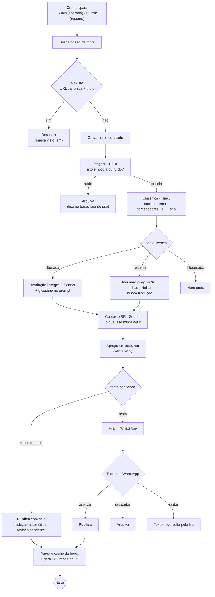
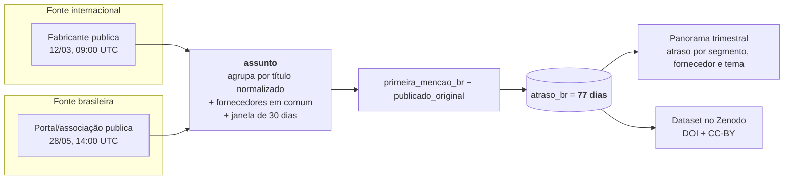
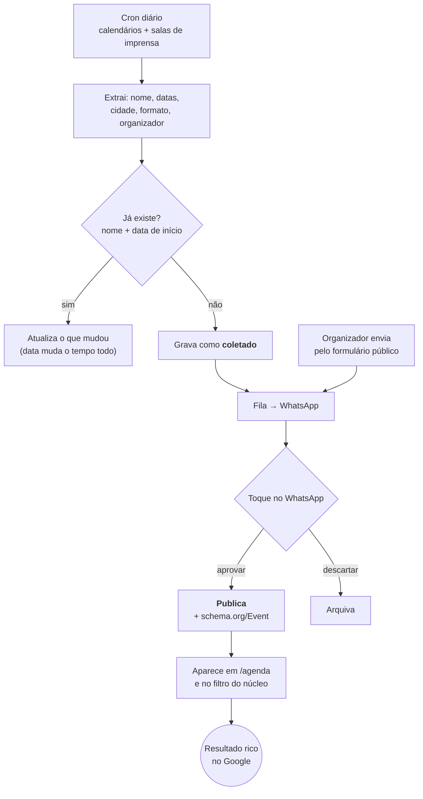
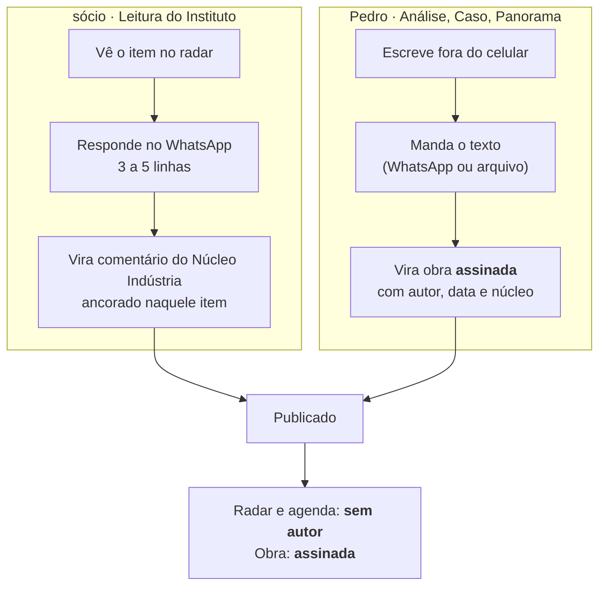

# Instituto Automação — Fluxos

> O caminho de cada coisa, da origem à tela. Quatro fluxos: **o item**, **o atraso**,
> **o evento** e **a obra**.

---

## 1. O item — da fonte à página

O caminho principal. Note onde estão os dois portões: a **licença** decide o que pode ser
feito com o texto, e a **confiança** decide se precisa de gente antes de publicar.



**Por que dois caminhos de publicação.** "Primeira mão" e "esperar aprovação humana" são
incompatíveis. A saída é honesta em vez de esperta: fonte liberada e confiável vai ao ar
sozinha **com o selo dizendo que ninguém revisou ainda**, e o selo some quando alguém
revisa. O leitor sabe o que está lendo.

**Onde o custo é contido.** A triagem barata roda antes de qualquer coisa cara. Item que
não passa na triagem nunca chega no Sonnet. E `custo_dia` corta o coletor no teto.

---

## 2. O atraso — a pergunta-assinatura virando dado

Este fluxo não produz página nenhuma no começo. Produz **a base do Panorama** e a resposta
da pergunta que o Instituto persegue.



⚠️ **Fonte brasileira entra no radar mesmo sem ser publicada.** Ela não é pauta — é o
instrumento de medição. Sem ela não existe atraso, e sem atraso não existe a pergunta.

⚠️ **Não dá para reconstruir depois.** Notícia sai do ar, feed guarda só as últimas
dezenas de itens. Cada dia sem coletar é um dia que nunca mais volta.

---

## 3. O evento — o ativo durável



Evento passa **sempre** por aprovação — são poucos por semana, e data errada em agenda
destrói a confiança na agenda inteira.

---

## 4. A obra — como o conteúdo assinado entra

Dois caminhos, calibrados por quem escreve. É aqui que o "sem backoffice" prova que vale.



**Por que o formato do sócio é curto de propósito.** Parceiro ocupado com formato longo
some no mês 2. Três a cinco linhas por cima de um item que ele já ia ler de qualquer jeito
é atrito quase zero — e é o suficiente para o núcleo Indústria ter voz própria.

**Por que a obra é assinada e o radar não.** Autoridade não transfere de marca anônima para
pessoa, e é autoridade pessoal o objetivo principal do projeto. O IPEA não assina o
clipping; assina o relatório.

---

## 5. Estados

Um item e um evento vivem no mesmo vocabulário:

```
coletado → (triagem) → classificado → traduzido/resumido → publicado
                ↓                              ↓
            arquivado                      corrigido
```

- **arquivado** não é apagado: fica na base, conta para o Panorama, só não aparece no site.
- **corrigido** gera registro em `correcao`, com data e texto — exigência da política
  editorial, e é o que separa veículo de blog.
