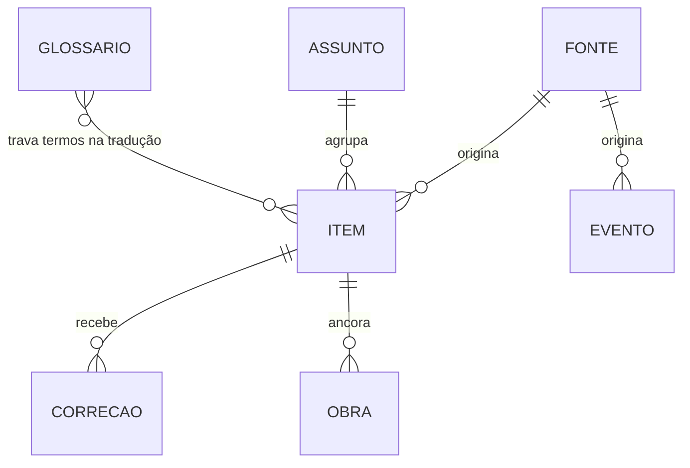

# Instituto Automação — Modelo de dados

> D1 (SQLite). Tudo em **UTC** no banco; exibição em `America/Sao_Paulo`.
>
> **A regra que rege este arquivo:** classificação rica desde o item nº 1, mesmo que a tela
> não mostre nada disso hoje. Notícia sai do ar e feed não guarda histórico — o que não for
> gravado agora está perdido para sempre.



---

## fonte

A tabela mais importante do projeto: é ela que decide o que o pipeline **pode** fazer com
cada texto.

```sql
CREATE TABLE fonte (
  id                TEXT PRIMARY KEY,
  nome              TEXT NOT NULL,
  veiculo           TEXT,                     -- editora/empresa por trás
  url_site          TEXT NOT NULL,
  url_feed          TEXT,                     -- RSS/Atom; NULL = raspagem
  tipo              TEXT NOT NULL,            -- o MEIO: 'press' | 'imprensa' | 'associacao' | 'academico'
                                              -- | 'calendario' | 'social' | 'forum' | 'video' | 'release'
  idioma            TEXT NOT NULL,            -- 'en' | 'de' | 'pt' | 'es'
  pais              TEXT NOT NULL,
  nucleo            TEXT,                     -- palpite inicial; o item pode ser reclassificado
  licenca           TEXT NOT NULL DEFAULT 'resumo',   -- 'liberada' | 'resumo' | 'bloqueada'
  licenca_evidencia TEXT,                     -- link da página que autoriza. Sem isto NÃO sobe para 'liberada'
  licenca_conferida TEXT,                     -- data
  confianca         TEXT NOT NULL DEFAULT 'media',    -- 'alta' | 'media' | 'baixa'
  marca_relogio     INTEGER NOT NULL DEFAULT 0,       -- 1 = fonte BR que serve para medir atraso
  peso              INTEGER NOT NULL DEFAULT 5,
  intervalo_min     INTEGER NOT NULL DEFAULT 60,      -- 15 para liberada de alta confiança
  colheita          TEXT NOT NULL DEFAULT 'feed',     -- 'feed' | 'sitemap'
  ativo             INTEGER NOT NULL DEFAULT 1,

  -- o veredito do robots.txt, conferido pelo coletor e PUBLICADO no inventário
  robots_permite    INTEGER,                  -- NULL = não conferido; 0 = a fonte diz não
  robots_atraso     REAL,                     -- Crawl-delay em segundos, se ela pedir
  robots_motivo     TEXT,                     -- legível por humano, vai para /blueprints
  robots_conferido  TEXT,                     -- reconferido a cada 7 dias

  -- a VOZ: pessoa pública que publica com nome próprio
  pessoa            TEXT,                     -- NULL = é redação, não pessoa
  pessoa_papel      TEXT,                     -- por que essa pessoa importa

  ultima_coleta     TEXT,
  ultimo_erro       TEXT,
  criado_em         TEXT NOT NULL
);
```

**`licenca` é regra no código, não julgamento caso a caso.** O pipeline nega por padrão:
qualquer coisa diferente de `liberada` só gera resumo próprio. Fonte nova nasce `resumo` e
só sobe depois que alguém leu os termos e gravou `licenca_evidencia`.

**`marca_relogio`** é a fonte brasileira que entra no radar sem ser publicada: ela existe
para marcar quando o assunto chegou ao Brasil.

**`robots_*` não é metadado de infraestrutura — é conteúdo.** O veredito aparece em
`/blueprints` com o motivo e a data em que foi conferido, e o QA garante o invariante:
nenhum item na base vem de fonte com `robots_permite = 0`. Fonte cujo `robots.txt` sequer
pode ser lido também fica em 0 — sem regra legível não há autorização a supor.

**`colheita`** é o caminho alternativo para quem fecha o RSS. O `robots.txt` do Canaltech diz
`Disallow: /rss/` e, no mesmo arquivo, anuncia o `sitemap-news`. A fonte não fechou a porta,
indicou outra — e o sitemap traz título, data e URL, que é 100% do que a medição de atraso
precisa.

**`pessoa` é um EIXO, não um valor de `tipo`.** `tipo` diz o MEIO (imprensa, fórum, social);
`pessoa` diz de QUEM é a assinatura. Um blog pessoal é meio *imprensa* **com** pessoa; a IEEE
Spectrum é meio *imprensa* **sem** pessoa. Acrescentar `'pessoa'` à lista de `tipo` teria
continuado misturando meio e papel — que era exatamente o defeito que essa coluna corrige. E
a distinção é substantiva para o Giro: *"a IEEE Spectrum noticiou"* e *"Rodney Brooks
escreveu"* não pesam igual.

---

## assunto

O coração da pergunta-assinatura. Agrupa itens de fontes e idiomas diferentes que falam da
mesma coisa, e é onde o atraso é medido.

```sql
CREATE TABLE assunto (
  id                   TEXT PRIMARY KEY,
  rotulo               TEXT NOT NULL,          -- título normalizado do primeiro item
  chave                TEXT NOT NULL,          -- hash de normalização, usado no agrupamento
  fornecedores         TEXT,                   -- JSON; o sinal mais forte de "é a mesma coisa"
  nucleo               TEXT,
  tema                 TEXT,                   -- JSON

  publicado_original   TEXT,                   -- 1ª publicação em qualquer lugar
  fonte_original       TEXT REFERENCES fonte(id),
  primeira_mencao_br   TEXT,                   -- 1ª publicação em fonte pt-BR
  fonte_br             TEXT REFERENCES fonte(id),
  atraso_br_dias       INTEGER,                -- primeira_mencao_br − publicado_original
  atraso_apurado_em    TEXT,

  qtd_itens            INTEGER NOT NULL DEFAULT 1,
  criado_em            TEXT NOT NULL
);

CREATE INDEX idx_assunto_chave  ON assunto(chave);
CREATE INDEX idx_assunto_atraso ON assunto(atraso_br_dias) WHERE atraso_br_dias IS NOT NULL;
```

**Agrupamento no P0:** título normalizado (sem acento, sem stopword, ordenado) + fornecedores
em comum + janela de 30 dias. 🔮 Embeddings quando o simples errar demais.

`atraso_br_dias` fica `NULL` enquanto o Brasil não mencionou — e **um assunto que segue NULL
depois de meses é dado, não falha**: é justamente o que nunca chegou aqui.

---

## item

```sql
CREATE TABLE item (
  id                 TEXT PRIMARY KEY,
  fonte_id           TEXT NOT NULL REFERENCES fonte(id),
  assunto_id         TEXT REFERENCES assunto(id),
  nucleo             TEXT NOT NULL,
  slug               TEXT UNIQUE,              -- imutável depois de publicado

  titulo             TEXT NOT NULL,            -- em PT-BR
  titulo_original    TEXT,
  url                TEXT NOT NULL,            -- da fonte
  url_canonica       TEXT NOT NULL,            -- sem utm etc. — é por aqui que se deduplica
  idioma_origem      TEXT NOT NULL,

  modo               TEXT NOT NULL,            -- 'traducao' | 'resumo'
  corpo              TEXT,                     -- tradução integral (só se licenca='liberada')
  resumo             TEXT,                     -- 3 a 5 linhas, redação própria
  contexto_br        TEXT,                     -- "o que isso muda aqui" — a camada que justifica o site

  tipo_de_item       TEXT,                     -- 'lancamento' | 'caso' | 'regulacao' | 'mercado' | 'pesquisa'
  tema               TEXT,                     -- JSON
  fornecedores       TEXT,                     -- JSON
  uf                 TEXT,

  publicado_fonte    TEXT NOT NULL,            -- quando saiu na fonte
  coletado_em        TEXT NOT NULL,
  publicado_em       TEXT,                     -- quando saiu AQUI
  minutos_apos_fonte INTEGER,                  -- o relógio: publicado_em − publicado_fonte

  status             TEXT NOT NULL DEFAULT 'coletado',  -- coletado|classificado|publicado|arquivado
  motivo_arquivo     TEXT,
  revisado_humano    INTEGER NOT NULL DEFAULT 0,
  revisor            TEXT,
  revisado_em        TEXT,

  og_key             TEXT,                     -- chave no R2
  criado_em          TEXT NOT NULL
);

CREATE UNIQUE INDEX idx_item_canonica ON item(url_canonica);
CREATE INDEX idx_item_publicado ON item(nucleo, status, publicado_em DESC);
CREATE INDEX idx_item_assunto   ON item(assunto_id);
```

**`minutos_apos_fonte` é conteúdo, não metadado.** É o *"publicado 14 min após a fonte"* que
explica o produto inteiro sem uma linha de texto institucional.

**`revisado_humano = 0`** é o que acende o selo "tradução automática · revisão pendente". O
selo some quando alguém revisa — honestidade em vez de esperteza.

**Arquivado não é apagado:** continua contando para o Panorama e para o atraso, só não
aparece no site.

---

## evento

```sql
CREATE TABLE evento (
  id            TEXT PRIMARY KEY,
  slug          TEXT UNIQUE,
  nucleo        TEXT NOT NULL,
  nome          TEXT NOT NULL,
  descricao     TEXT,
  inicio        TEXT NOT NULL,                -- data; hora quando houver
  fim           TEXT,
  cidade        TEXT,
  uf            TEXT,
  pais          TEXT NOT NULL DEFAULT 'BR',
  formato       TEXT NOT NULL,                -- 'presencial' | 'online' | 'hibrido'
  organizador   TEXT,
  url           TEXT,
  preco         TEXT,                         -- 'gratuito' | 'pago' | texto livre
  origem        TEXT NOT NULL,                -- 'coletor' | 'formulario' | 'manual'
  fonte_id      TEXT REFERENCES fonte(id),
  destaque      INTEGER NOT NULL DEFAULT 0,
  status        TEXT NOT NULL DEFAULT 'coletado',
  criado_em     TEXT NOT NULL,
  atualizado_em TEXT
);

CREATE INDEX idx_evento_agenda ON evento(status, inicio);
```

Evento passa **sempre** por aprovação humana: data errada em agenda destrói a confiança na
agenda inteira, e ela é o ativo mais durável do projeto.

---

## obra

O conteúdo assinado. Separado de `item` de propósito — são naturezas diferentes, e misturar
os dois é o que faz um agregador parecer um blog.

```sql
CREATE TABLE obra (
  id          TEXT PRIMARY KEY,
  slug        TEXT UNIQUE NOT NULL,
  nucleo      TEXT NOT NULL,
  formato     TEXT NOT NULL,        -- 'leitura' | 'analise' | 'caso' | 'panorama'
  titulo      TEXT NOT NULL,
  lead        TEXT,
  corpo       TEXT NOT NULL,        -- markdown
  autor       TEXT NOT NULL,        -- 'Pedro Oliveira' | 'Núcleo Indústria'
  assinada    INTEGER NOT NULL DEFAULT 1,
  item_id     TEXT REFERENCES item(id),   -- Leitura ancora num item do radar
  publicado_em TEXT,
  status      TEXT NOT NULL DEFAULT 'rascunho',
  criado_em   TEXT NOT NULL
);
```

`assinada = 0` só para a Leitura do Instituto, que sai como voz do núcleo. Análise, Caso e
Panorama são sempre assinados — é disso que a autoridade pessoal depende.

---

## giro

A edição semanal. **Não é `obra` de propósito:** obra é texto assinado, com responsabilidade
de quem assina; o giro é montado a partir da base e auditado por máquina. Misturar os dois
borraria a linha que o projeto inteiro existe para manter.

```sql
CREATE TABLE giro (
  id             TEXT PRIMARY KEY,
  slug           TEXT UNIQUE NOT NULL,     -- '2026-s36': semana ISO
  inicio         TEXT NOT NULL,            -- segunda 00:00 UTC, inclusivo
  fim            TEXT NOT NULL,            -- segunda seguinte, exclusivo
  rotulo         TEXT NOT NULL,            -- '24 a 30 de agosto de 2026'

  titulo         TEXT NOT NULL,
  lead           TEXT,
  destaque_texto TEXT,
  por_nucleo     TEXT,                     -- JSON [{nucleo, frase}]

  agregado       TEXT NOT NULL,            -- JSON do agregado inteiro, CONGELADO
  auditoria      TEXT,                     -- JSON: o que foi conferido, e o que reprovou
  simulado       INTEGER NOT NULL DEFAULT 0,

  status         TEXT NOT NULL DEFAULT 'rascunho',   -- 'rascunho' | 'publicado' | 'arquivado'
  motivo_rascunho TEXT,                    -- por que NÃO saiu
  publicado_em   TEXT,
  criado_em      TEXT NOT NULL
);
```

**`slug` é a semana ISO, e a fronteira é fixa.** Janela móvel de 7 dias daria um recorte
diferente a cada execução, e a edição deixaria de ser reproduzível — reprodutível é o mínimo
para um veículo que publica os próprios dados.

**`agregado` é congelado.** A página lê dali e não refaz a conta: o giro da semana 36 tem de
continuar dizendo o que dizia na semana 36, mesmo que a base mude depois. Sem isso,
"publicamos os nossos dados" viraria "publicamos os dados de hoje".

**`auditoria` é gravada inclusive quando passa.** Auditoria que só aparece no erro não dá
para verificar. E `motivo_rascunho` é publicado em `/blueprints`: auditoria que reprova em
silêncio é auditoria que ninguém confere.

---

## glossario

Infraestrutura de tradução que também é página pública.

```sql
CREATE TABLE glossario (
  termo_origem TEXT NOT NULL,
  idioma       TEXT NOT NULL,
  termo_pt     TEXT NOT NULL,
  nota         TEXT,
  travado      INTEGER NOT NULL DEFAULT 1,   -- 1 = obrigatório no prompt
  nucleo       TEXT,
  criado_em    TEXT NOT NULL,
  PRIMARY KEY (termo_origem, idioma)
);
```

Os termos `travado = 1` são injetados no prompt de tradução como dicionário obrigatório. É o
que impede o LLM de escrever "controle de circuito fechado" e queimar a autoridade na
primeira linha.

---

## Apoio

```sql
-- Registro público de correção. Separa veículo de blog.
CREATE TABLE correcao (
  id        TEXT PRIMARY KEY,
  item_id   TEXT REFERENCES item(id),
  obra_id   TEXT REFERENCES obra(id),
  texto     TEXT NOT NULL,
  data      TEXT NOT NULL
);

-- Kill-switch de custo. Sem isto, um feed que enlouquece vira uma conta que não é sua.
CREATE TABLE custo_dia (
  data        TEXT PRIMARY KEY,
  tokens_in   INTEGER NOT NULL DEFAULT 0,
  tokens_out  INTEGER NOT NULL DEFAULT 0,
  brl         REAL    NOT NULL DEFAULT 0,
  itens       INTEGER NOT NULL DEFAULT 0,
  pausado_em  TEXT
);

-- Lista própria. No v0 só captura; o envio vem depois.
CREATE TABLE assinante (
  email      TEXT PRIMARY KEY,
  nucleos    TEXT,          -- JSON
  origem     TEXT,
  confirmado INTEGER NOT NULL DEFAULT 0,
  criado_em  TEXT NOT NULL
);
```

---

## O que o Panorama pergunta a esta base

Para não perder de vista o motivo de cada campo existir:

```sql
-- A pergunta-assinatura, por segmento
SELECT nucleo, COUNT(*) AS assuntos,
       ROUND(AVG(atraso_br_dias)) AS atraso_medio_dias
FROM assunto WHERE atraso_br_dias IS NOT NULL
GROUP BY nucleo;

-- O que NUNCA chegou ao Brasil (o achado mais interessante costuma ser este)
SELECT rotulo, publicado_original, fornecedores
FROM assunto
WHERE primeira_mencao_br IS NULL
  AND publicado_original < date('now','-180 days');

-- Quem sobe e quem some
SELECT fornecedor, trimestre, COUNT(*)
FROM item, json_each(item.fornecedores) AS fornecedor
GROUP BY 1, 2;

-- Onde o país é deserto de evento
SELECT uf, COUNT(*) FROM evento WHERE pais='BR' GROUP BY uf ORDER BY 2;
```
