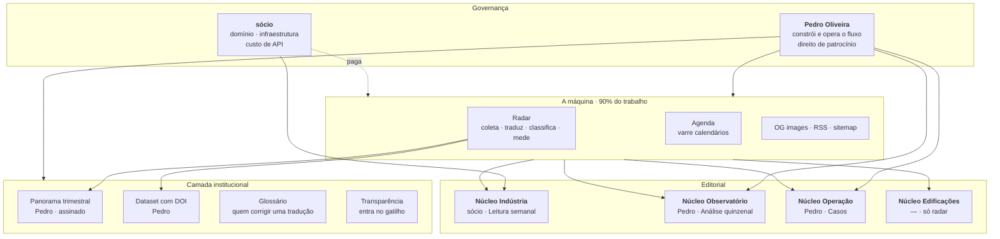

# Instituto Automação — Organograma

> Quem faz o quê. São **duas pessoas e uma máquina** — e a máquina é a que mais trabalha.
> Isso não é detalhe de operação: é o desenho que faz o projeto sobreviver a uma semana ruim.

---

## O desenho

---

## Divisão por responsabilidade

| Frente | Pedro | sócio | Máquina |
|---|:--:|:--:|:--:|
| Domínio e DNS | | ✅ | |
| Infraestrutura e custo de API | | ✅ | |
| Código, deploy e operação do fluxo | ✅ | | |
| Coleta, tradução, classificação | | | ✅ |
| **Obedecer o `robots.txt` de cada fonte** | | | ✅ |
| Medição do atraso BR | | | ✅ |
| **Giro da Semana — agregar, redigir, auditar** | | | ✅ |
| **Auditar o Giro e reter o que reprova** | | | ✅ |
| Decidir o que fica no radar (arXiv, teto de custo) | ✅ | | |
| Classificar licença de fonte (`liberada`) | ✅ | ✅ | |
| Agenda — varredura | | | ✅ |
| Agenda — aprovação | ✅ | ✅ | |
| Núcleo Indústria — Leitura | | ✅ | |
| Núcleo Observatório — Análise | ✅ | | |
| Núcleo Operação — Casos | ✅ | | |
| Glossário — travar termo | ✅ | ✅ | |
| Panorama e dataset | ✅ | | |
| Relação com fontes e organizadores | ✅ | ✅ | |
| Patrocínio e receita de mídia | ✅ | | |

---

## O contrato de esforço

O ponto do desenho é este: **o trabalho humano é pequeno e previsível.**

| Quem | O que | Quanto por semana |
|---|---|---|
| Máquina | coleta, traduz, classifica, mede, publica o que é liberado | 24 h por dia |
| Pedro | fila de aprovação (o que não é automático) | ~10 min/dia |
| Pedro | Análise quinzenal | ~2 h a cada 15 dias |
| Pedro | manutenção do fluxo (corrigir o que quebrar) | ~1 h |
| sócio | Leitura do Instituto | 3 a 5 linhas, 1×/semana |
| Pedro | Panorama | ~8 h, **1× por trimestre** |

A soma cabe na capacidade real de quem tem Parresia, faculdade e mais quatro frentes
abertas — e é assim de propósito. O compromisso assumido é *manter a máquina rodando*
(acordo interno, ponto 1), não produzir conteúdo semanal.

---

## A fila de aprovação é a sessão de estudo

Vale dizer explicitamente porque muda como o trabalho é sentido: os 10 minutos diários de
aprovação **são** o mecanismo de entrar na área. É ler o que o mundo publicou de automação,
curado e em português, todo dia. O trabalho operacional e o aprendizado são a mesma ação —
e o glossário vira o caderno de vocabulário técnico, público.

---

## O que não é de ninguém (e precisa ser)

Buracos conhecidos, para não descobrir em novembro:

| Buraco | Consequência se ficar assim |
|---|---|
| **Propriedade do código** | domínio e infra são do sócio, patrocínio é do Pedro, e o código ficou sem dono declarado |
| **Quem responde por erro factual** | um "Instituto" publicando erro precisa de alguém que assine a correção |
| **Quem fala com organizador de feira** | a agenda cresce por inbound; sem dono, o e-mail fica sem resposta |
| **Quem decide sobre patrocínio de concorrente** | conflito entre a fase de leads e a de mídia — decidir antes de o dinheiro aparecer |
| **O que acontece se um dos dois sair** | conteúdo e base não têm destino combinado |

Os cinco estão em acordo interno. Não precisam de advogado — precisam **estar
escritos**, numa mensagem respondida com "fechado".

---

## Escala futura

🔮 Quando houver um terceiro núcleo quente, ele entra como **curador convidado** com o mesmo
formato do sócio: 3 a 5 linhas por cima do radar, sem assinatura pessoal enquanto a marca
for impessoal. O papel já existe no desenho; só não está ocupado.

🔮 Se o Instituto ganhar entidade própria (CNPJ), o organograma ganha um nível acima:
mantenedora → conselho editorial → núcleos. Hoje seria fantasia — dois sócios não formam
conselho.
