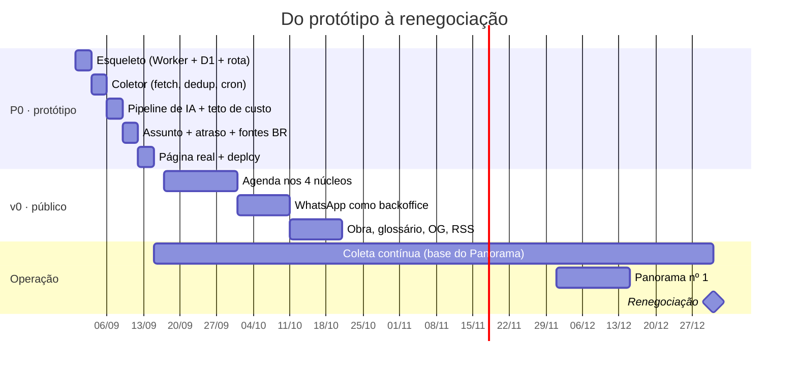

# Instituto Automação — Roadmap

> Marco atual: **P0 · protótipo mínimo funcional → 14/09/2026.**
> Compromisso contratado: máquina rodando até **31/12/2026** (acordo interno).

## Sprints

Sprints de uma semana. **São 7 até o site público**, mais uma em dezembro para o Panorama.
Entre a 7 e a 8 não há construção: são ~6 semanas de **operação**, e é ela que faz a base do
Panorama existir. Essa parte não acelera.

| Sprint | Semana | Entrega | Marco |
|---|---|---|---|
| **0** ✅ | 30/08 | conceito · sistema de design · planning · Worker + schema + rotas · **coletor** | feito |
| **1** | 31/08 – 06/09 | fontes reais classificadas · **robots.txt obedecido** · sitemap de notícias · **Giro da Semana + vozes** · robustez do coletor | |
| **2** | 07/09 – 13/09 | pipeline de IA · teto de custo · atraso apurado · página com conteúdo real | 🎯 **P0 · 14/09** |
| **3** | 14/09 – 20/09 | agenda nos 4 núcleos · filtro por URL · `schema.org/Event` | |
| **4** | 21/09 – 27/09 | WhatsApp como backoffice: fila, aprovar/descartar/editar, Leitura | |
| **5** | 28/09 – 04/10 | obra assinada: Análise, Caso, Leitura | |
| **6** | 05/10 – 11/10 | glossário como tabela · OG image · RSS · sitemap | |
| **7** | 12/10 – 18/10 | os 4 núcleos no ar · política editorial · captura de e-mail · polimento | 🎯 **v0 · 18/10** |
| **8** | 1ª quinzena dez | Panorama nº 1 · dataset no Zenodo com DOI | 🎯 **31/12** |

A sprint 0 rendeu mais que o previsto — o coletor, que era da sprint 1, entrou junto. A folga
foi para a sprint 1, que absorve a parte imprevisível: **fonte real quebra de jeitos que
fixture nenhuma prevê.**

---

## P0 · Protótipo mínimo funcional — **14/09/2026**

**O que é "funcional":** o radar do núcleo Indústria coletando de verdade, traduzindo de
verdade e publicando numa página de verdade — com o relógio do atraso já rodando por baixo.
Um núcleo, publicação automática, sem aprovação humana ainda.

**O que NÃO entra no P0, de propósito:** WhatsApp, agenda, obra assinada, glossário como
tabela, OG image, RSS, os outros três núcleos, transparência. Tudo isso é v0.

| Bloco | Dias | Entrega |
|---|---|---|
| **1 · Esqueleto** | 1–3 | Worker + Hono + JSX no ar; schema D1 **completo** aplicado (inclusive `assunto`); rota `/industria` renderizando dado semente com o sistema de design |
| **2 · Coletor** | 4–6 | fetch + parse de RSS, dedup por `url_canonica`, `ctx.waitUntil`, Cron Trigger, 8–10 salas de imprensa `liberada` classificadas |
| **3 · Pipeline** | 7–9 | triagem (Haiku) → classificação → tradução integral (Sonnet) → contexto BR; glossário semente no código; `custo_dia` com teto que pausa |
| **4 · O atraso** | 10–12 | 3–4 fontes BR com `marca_relogio`; agrupamento em `assunto`; cálculo de `atraso_br_dias` |
| **5 · Página** | 13–15 | `/industria` e `/industria/<slug>` com conteúdo real; cache na borda; deploy; ajuste do design contra notícia de verdade |

⚠️ **O schema entra inteiro no bloco 1, mesmo sem tela.** Classificação rica e medição de
atraso não são reconstituíveis: notícia sai do ar e feed guarda só as últimas dezenas de
itens. Cada dia sem coletar é um dia perdido para sempre.

### Riscos do P0

| Risco | Mitigação |
|---|---|
| **Acesso à Cloudflare do sócio** — a infra é dele e sem isso não há deploy | resolver **antes do dia 1**; é a única dependência externa bloqueante |
| Feed que não é RSS (raspagem) | no P0, só fonte com feed. Raspagem fica para o v0 |
| Conta de IA estourando | teto no bloco 3, antes de ligar volume |
| 15 dias com Parresia e faculdade no meio | os blocos são de 3 dias e independentes: se um atrasar, o marco desliza mas nada quebra |

---

## v0 · Público — proposta: **31/10/2026**

O que transforma o protótipo em veículo.

| # | Entrega | Por quê agora |
|---|---|---|
| 1 | **Agenda nos 4 núcleos** com `schema.org/Event` | é o ativo mais durável e o que traz tráfego recorrente e inbound |
| 2 | **WhatsApp como backoffice** (aprovar, publicar, Leitura do sócio) | sem isso o sócio não publica e o núcleo Indústria não tem voz |
| 3 | **Obra assinada** (Análise, Leitura, Caso) | é o que constrói autoridade — o radar sozinho não constrói |
| 4 | **Glossário** como tabela + página | a qualidade de tradução para de depender de sorte |
| 5 | **OG image** gerada + **RSS** por núcleo | distribuição; o link precisa circular com cara de veículo |
| 6 | Os outros três núcleos (Operação e Edificações em Radar) | o guarda-chuva prometido passa a existir |
| 7 | Página de política editorial e correções | o que separa veículo de blog |
| 8 | Captura de e-mail (sem envio ainda) | começar a lista o quanto antes; ela é o único ativo próprio |

---

## Depois do v0

| Fase | Foco | Métrica | Quando |
|---|---|---|---|
| 1 | autoridade → leads | conversas qualificadas | mês 1–6 |
| 2 | ativo de mídia | assinantes da newsletter | mês 6–12 |
| 3 | comunidade e eventos | gente na sala | ano 2 |

**Marcos que não podem escorregar:**

- **Uma peça original com dado próprio por trimestre.** É a única coisa não automatizável e
  a única que constrói o que o projeto quer. Sem ela, o radar bonito não vira nada.
- **Panorama nº 1 em dezembro**, com ~3 meses de base. Chega na renegociação de 31/12 com
  obra publicada, não com promessa.
- **Dataset no Zenodo com DOI e CC-BY**, junto do Panorama nº 1. É o que torna o Instituto
  citável em TCC, dissertação e artigo — e é subir um CSV.

---

## Backlog (sem data)

| Item | Nota |
|---|---|
| Busca (FTS5 do D1) | quando houver conteúdo o bastante para procurar |
| Fila (Cloudflare Queues) | se o coletor passar de ~30 s por invocação |
| Embeddings para agrupar assunto | **deixou de ser dívida técnica.** O Giro publica toda semana quantos assuntos ficaram com uma fonte só (49 na primeira edição) — o número está na cara do leitor, e boa parte dele é a mesma notícia que o título não juntou |
| Envio da newsletter | quando houver lista que justifique |
| Diretório de fornecedores | fase 2, é receita |
| Página de "perguntas abertas" para orientadores | junto do dataset com DOI |
| Espanhol nas fontes | depois de EN e DE estarem estáveis |
| Repositório público | quando estiver apresentável **e** o acordo do código estiver escrito |
| **Marca gráfica (logotipo)** | **futuro breve.** Hoje o wordmark centralizado do cabeçalho faz o papel — é assim que jornal e revista acadêmica vivem sem símbolo. Quando entrar, o símbolo deve nascer no mesmo vocabulário das capas geradas (varredura de radar, malha de pontos), porque aí ele já vem com sistema em vez de virar um desenho solto. Serve também de favicon e de assinatura na OG image |
| **Newsletter do Giro** | a lista de e-mail já existe e não tem envio; o Giro é o conteúdo óbvio para ela, e é semanal por natureza |
| **Mais vozes brasileiras** | hoje só uma (Rodrigo Ghedin), e nenhuma de automação industrial. É o buraco mais visível da lista de fontes |
| **Coletor por API com credencial** | GitHub REST, Reddit OAuth, YouTube Data API. São as saídas legítimas das 4 fontes que o `robots.txt` recusa — e o robots do GitHub literalmente oferece a API no comentário do topo. É JSON, não RSS: coletor novo, não um parser a mais |
| **Pedido de acesso às publicações** | Control Engineering, Automation World, WEG. Não é código, é uma mensagem — e o Control Engineering merece segunda medição: o `robots.txt` dele permite, o 403 veio do WAF |
| Sitemap onde o feed é pobre | hoje o sitemap-news é saída para quem proíbe o RSS; algumas fontes têm sitemap mais completo que o próprio feed |
| OG image rasterizada | ⚠️ não é trivial num Worker: `og:image` em SVG não é aceito pelo WhatsApp nem pelo LinkedIn, e rasterizar exige biblioteca wasm (`workers-og`). O desenho já existe — falta só o encoder |

---

## Próximos passos imediatos

Em ordem, e os três primeiros não são código:

1. **Acesso à conta Cloudflare do sócio** — dependência bloqueante do deploy. Confirmar
   também o domínio exato (TLD) e onde está o DNS.
2. **Mandar os pontos do acordo interno** e ter um "fechado" por escrito.
   Principalmente: escopo de "manter rodando", quem paga a API, de quem é o código.
3. **Classificar 8–10 salas de imprensa** de fabricante como `liberada`, com
   `licenca_evidencia` preenchida — é o trabalho braçal que destrava tudo
   ([FONTES.md](FONTES.md)).
4. Escolher as 3–4 fontes brasileiras que vão **marcar o relógio** — com o sócio, que
   conhece o circuito.
5. Criar o projeto Cloudflare (Worker + D1 + R2) e subir o schema.
6. Bloco 1 do P0.

---

## Decisões travadas

| # | Decisão | Data |
|---|---|---|
| 1 | Guarda-chuva de 4 núcleos + camada institucional | 30/08 |
| 2 | Fonte internacional, público brasileiro, tradução em primeira mão | 30/08 |
| 3 | Impessoal no fluxo, assinado na obra | 30/08 |
| 4 | Transparência por gatilho | 30/08 |
| 5 | Indústria (sócio) e Observatório (Pedro) quentes | 30/08 |
| 6 | Operação recebe o formato Casos | 30/08 |
| 7 | Licença da fonte como regra no código, negando por padrão | 30/08 |
| 8 | Um Worker só · Hono + JSX · D1 · WhatsApp como backoffice | 30/08 |
| 9 | Tema azul + laranja; paleta curta de duas cores | 30/08 |
| 10 | **Só português, para sempre** — rota sem prefixo de idioma | 30/08 |
| 11 | **Repositório privado agora**, público depois | 30/08 |
| 12 | **Pergunta-assinatura: o atraso entre a fronteira e o chão de fábrica daqui** | 30/08 |
| 13 | **P0 em 15 dias — 14/09/2026** | 30/08 |
| 14 | Analytics sem cookie · nunca republicar imagem de terceiro | 30/08 |

## Ainda em aberto

| # | Pergunta | Bloqueia |
|---|---|---|
| 1 | Domínio exato (TLD) e onde está o DNS | deploy |
| 2 | Acesso à conta Cloudflare do sócio | deploy |
| 3 | Data da 2ª parcela | nada técnico |
| 4 | Data-alvo do v0 (proposta: 31/10) | planejamento |
| 5 | Identidade visual além do sistema de design (marca, logotipo) | nada técnico no P0 |
